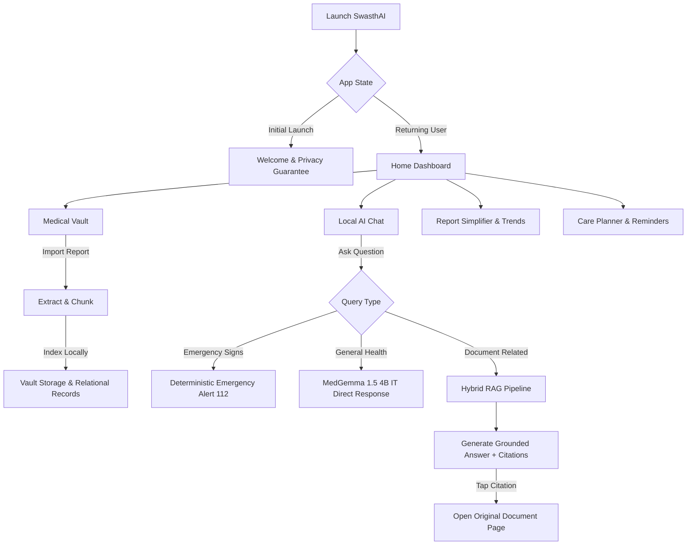
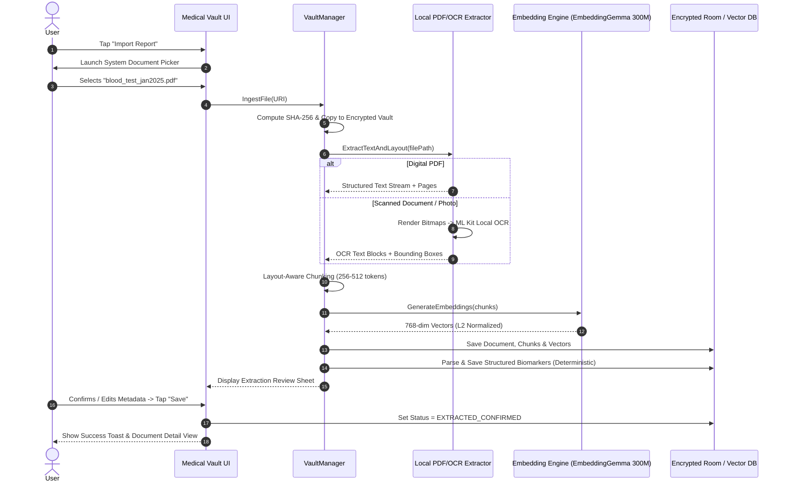
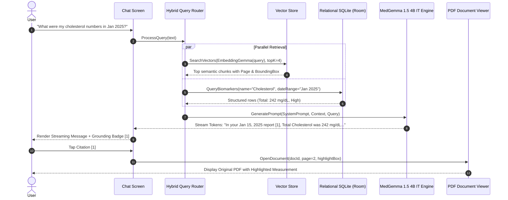
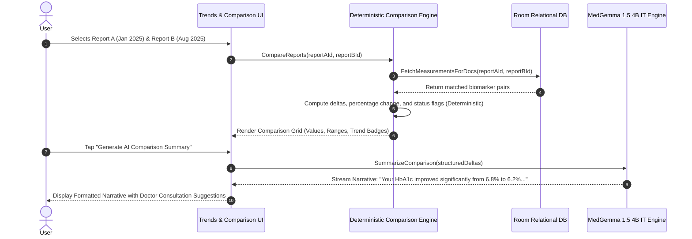
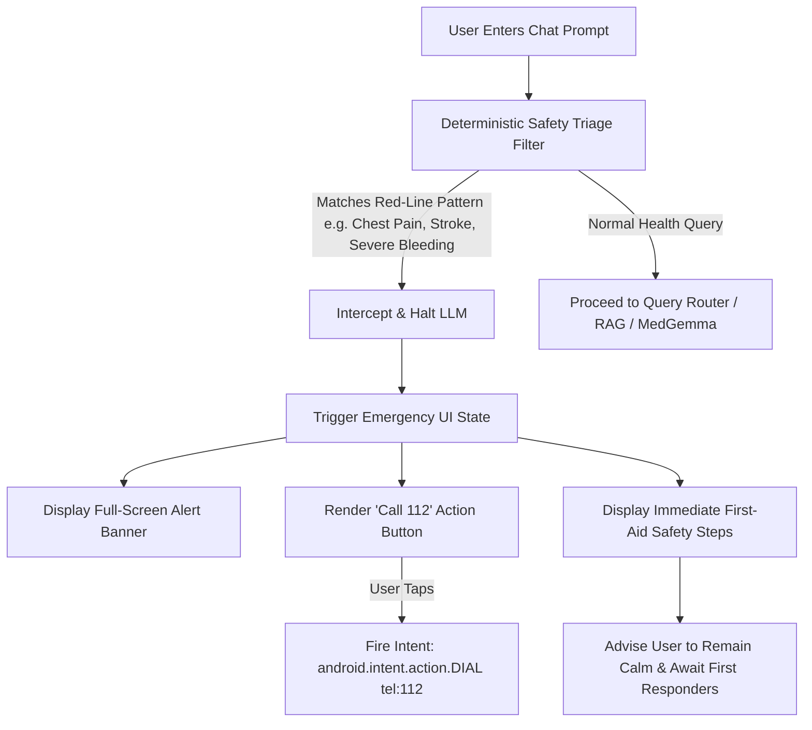

# SwasthAI: Detailed User Flows & Interaction Journeys

**Document Version:** 1.1.0  
**Classification:** UX & Interaction Architecture  
**Status:** Approved for Implementation Planning (Revised Single Generative Model Architecture)  

---

## 1. Primary User Journey Architecture

SwasthAI centers on an integrated, highly intuitive workflow that transitions effortlessly from general inquiries to document-grounded insights, longitudinal tracking, and responsible care planning.

---

## 2. User Flow 1: Document Ingestion, OCR & Extraction

### 2.1 Narrative Journey
1. The user navigates to the **Medical Vault** tab and taps the floating action button **"Import Report"**.
2. Android System Document Picker opens. The user selects a digital or scanned lab report (PDF or Image).
3. The app hashes the file (SHA-256) and stores a secure copy in `context.filesDir/vault/`.
4. The processing sheet appears with a progressive step indicator:
   - Step 1: *Analyzing document structure...*
   - Step 2: *Extracting text & table data...* (PDF text stream or ML Kit on-device OCR)
   - Step 3: *Generating local semantic embeddings...* (EmbeddingGemma 300M)
   - Step 4: *Structuring lab biomarkers...* (Deterministic regex/table parser)
5. The user is presented with a **Review & Confirm Extracted Details** sheet showing the detected report date, lab name, and extracted test counts.
6. The user adjusts any misread fields (e.g., corrects the report date) and taps **"Save to Vault"**.

### 2.2 Sequence & Flow Diagram

---

## 3. User Flow 2: Grounded Local RAG & Document Citation Verification

### 3.1 Narrative Journey
1. The user opens an existing conversation or starts a new chat thread.
2. The user types: *"What were my cholesterol numbers in my January test, and are they concerning?"*
3. The hybrid query router identifies:
   - Entity: Cholesterol / Lipid Panel.
   - Temporal constraint: January 2025.
4. The system queries structured relational tables for exact lipid numbers and executes vector search over document chunks.
5. Context is synthesized into a constrained prompt and sent to the single generative engine: **MedGemma 1.5 4B IT**.
6. Tokens stream into the UI. The answer includes inline citations `[1]`, `[2]` and a prominent **"Grounded in: Blood Test Jan 2025"** badge.
7. The user taps citation `[1]`.
8. A bottom drawer opens displaying:
   - Source: *Dr. Lal PathLabs - Jan 15, 2025*
   - Page 2, Lipid Profile section
   - Exact text snippet: *"Total Cholesterol: 242 mg/dL [Desirable: <200]"*
   - Button: **"View Original Report"** (which opens the built-in PDF viewer directly on Page 2).

### 3.2 Sequence & Flow Diagram

---

## 4. User Flow 3: Longitudinal Report Comparison

### 4.1 Narrative Journey
1. The user visits the **Report Simplifier & Trends** tab.
2. The screen shows a list of saved diagnostic panels. The user selects **"Compare Reports"**.
3. The user picks:
   - Report A: *Complete Blood Profile (Jan 15, 2025)*
   - Report B: *Complete Blood Profile (Aug 10, 2025)*
4. The system runs a deterministic SQL join across compatible canonical test names.
5. The UI renders a structured comparison grid:
   - Test Name (e.g., Fasting Blood Sugar, HbA1c, Total Cholesterol, Hemoglobin).
   - Value Jan 2025 vs Value Aug 2025.
   - Reference Range.
   - Trend Delta (e.g., HbA1c: 6.8% -> 6.2%, **-0.6% Improved** [Green badge]).
6. Below the grid, an **"AI Clinical Summary"** button allows generating an on-device plain-language narrative via MedGemma, explaining what lifestyle or physiological factors correlate with these verified changes.

### 4.2 Sequence & Flow Diagram

---

## 5. User Flow 4: Deterministic Emergency Escalation (India 112 Standard)

### 5.1 Narrative Journey
1. The user types into chat: *"My father has sudden crushing chest pain radiating to his left arm and he is sweating heavily."*
2. Before the message is passed to MedGemma or tokenized, the **Deterministic Safety Triage Engine** evaluates the input against red-line clinical criteria (Acute Coronary Syndrome keywords and regex).
3. The generation pipeline is intercepted immediately (< 5ms).
4. The screen shifts instantly to a high-contrast **Emergency Alert Modal**:
   - Title: **"EMERGENCY MEDICAL WARNING"** (Red banner, persistent vibration alert).
   - Warning: *"These symptoms indicate a potential medical emergency (possible heart attack). Immediate hospital attention is required."*
   - Immediate Actions:
     - Prominent Red Button: **"Call Emergency Services (112)"** (Launches phone dialer pre-filled with `112`).
     - Immediate First Aid: *"Keep patient sitting upright, loosen tight clothing, do not leave alone."*
5. The app explicitly states: *"SwasthAI cannot diagnose or treat emergencies. Please contact emergency services or go to the nearest emergency room immediately."*

### 5.2 Flowchart

---

## 6. User Flow 5: Multilingual Health Explanation (Hindi & English)

### 6.1 Narrative Journey
1. The user switches app language to **Hindi (हिंदी)** via the top navigation language toggle or settings.
2. The user opens an extracted Complete Blood Count report.
3. The user taps **"Explain in Hindi" (सरल हिंदी में समझें)**.
4. MedGemma 1.5 4B IT generates a plain-language summary:
   - *"आपके रक्त में हीमोग्लोबिन (Hemoglobin) का स्तर 10.5 g/dL है, जो सामान्य सीमा (12.0 - 15.0 g/dL) से कम है। इसका मतलब है कि आपके शरीर में लाल रक्त कोशिकाओं की कमी हो सकती है..."*
5. Notice that key medical entities (*Hemoglobin*, *g/dL*) and exact numerical values are preserved in their standard clinical representation, preventing linguistic ambiguity or translation distortion.

---

## 7. User Flow 6: Care Planning & Bounded Medication Reminders

### 7.1 Narrative Journey
1. The user imports a doctor's prescription PDF or types in chat: *"Doctor told me to take Metformin 500mg twice a day with meals."*
2. The AI assistant extracts the medication intention and outputs an interactive **Proposed Action Card**:
   - Medication: *Metformin*
   - Dosage: *500 mg*
   - Frequency: *Twice daily (08:00 AM, 08:00 PM)*
   - With Meals: *Yes*
   - Buttons: **"Set Reminders"** or **"Cancel"**.
3. The user reviews the details, edits the morning time to 08:30 AM, and taps **"Set Reminders"**.
4. The app invokes Android `WorkManager` / `AlarmManager` APIs to schedule local notification alarms.
5. At 08:30 AM, an Android system notification appears: *"Time for Metformin 500mg (With Breakfast)"* with options to "Mark as Taken" or "Snooze (15m)".

---

## 8. User Flow 7: Doctor Visit Summary Export

### 8.1 Narrative Journey
1. The user prepares for a specialist appointment and navigates to **Medical History -> Export Summary**.
2. The user checks the records to include:
   - Chronic Conditions: *Type 2 Diabetes (User Confirmed)*
   - Allergies: *Penicillin (User Confirmed)*
   - Current Medications: *Metformin 500mg, Atorvastatin 10mg*
   - Recent Abnormal Lab Tests: *Lipid Panel (Aug 2025), HbA1c (Aug 2025)*
3. The app renders a clean 1-page visual preview with provenance footnotes.
4. The user taps **"Export PDF"**.
5. The on-device PDF engine generates a clean A4 PDF file and opens the Android Share Sheet for printing or local saving.
