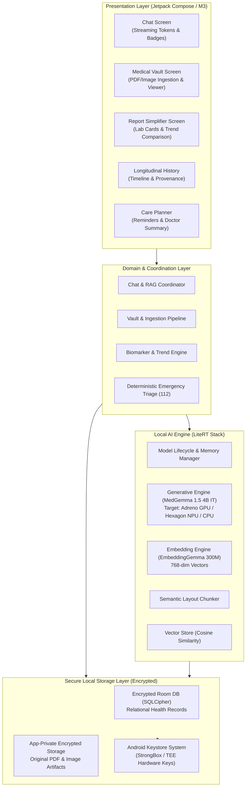
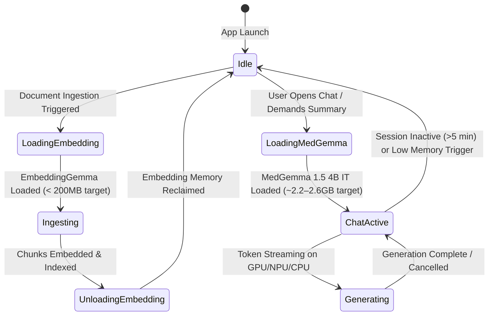
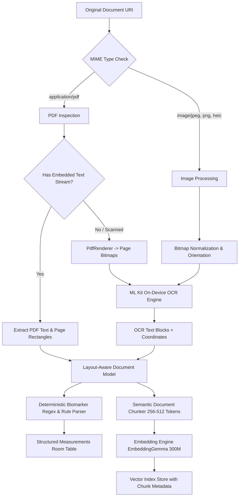
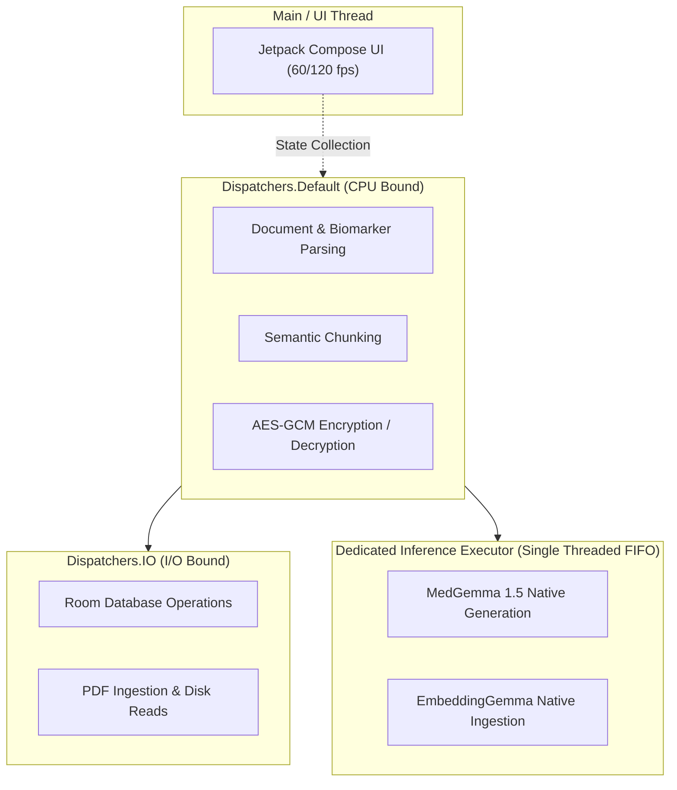

# SwasthAI: Comprehensive System Architecture & Engineering Blueprint

**Document Version:** 1.1.0  
**Classification:** Technical Architecture Specification  
**Status:** Approved for Implementation Planning (Revised Single Generative Model Architecture)  

---

## 1. Architectural Philosophy & Principles

SwasthAI is engineered around five fundamental principles:
1. **Uncompromising Air-Gap & Privacy:** No runtime network dependencies. The application operates in complete isolation from cloud servers.
2. **Clean, Reactive Architecture:** Strict separation of concerns following Android Clean Architecture principles, utilizing Unidirectional Data Flow (UDF) via Jetpack Compose and Kotlin Coroutines/Flow.
3. **Single Generative Model Strategy:** A single generative model (**MedGemma 1.5 4B IT**) serves as the unified conversational and medical reasoning engine, paired with a separate specialized local embedding model (**EmbeddingGemma 300M**) for semantic retrieval.
4. **Deterministic Primacy:** High-stakes operations (biomarker range checks, emergency triage, unit normalization, database deletion) are executed via deterministic code, using generative AI solely for synthesis, plain-language translation, and contextual explanation of verified data.
5. **Strict Hardware Governance:** Managing memory allocation, thermal headroom, and acceleration delegates to pursue an application target budget of **<= 3.5 GB peak RSS** on the Samsung Galaxy S25.

---

## 2. Multi-Module Project Structure

```
swasth-ai/
├── app/                                 # Application entry point, Dagger/Hilt setup, NavHost
├── core/
│   ├── common/                          # Result monads, dispatchers, date/time utilities
│   ├── designsystem/                    # Material 3 theme, typography, accessible colors, components
│   ├── database/                        # Room database, type converters, DAOs, migrations, SQLCipher
│   ├── datastore/                       # Encrypted proto datastore for user preferences
│   ├── security/                        # Android Keystore, AES-GCM crypto manager, StrongBox
│   └── domain/                          # Core domain models (Document, Measurement, Provenance)
├── ai/
│   ├── runtime/                         # LiteRT-LM C++/JNI bindings, Engine wrapper, delegate controller
│   ├── models/                          # Model manifest, asset loader, mmap weight controller
│   ├── generative/                      # MedGemma 1.5 4B IT prompt manager, multi-turn formatter
│   ├── embedding/                       # EmbeddingGemma 300M pipeline, vector math, L2 normalization
│   ├── vectorstore/                     # In-memory / SQLite vector index, Cosine Similarity engine
│   ├── chunker/                         # Layout-aware semantic chunking algorithms
│   └── safety/                          # Pre-LLM deterministic emergency rules (112), regex filters
└── feature/
    ├── chat/                            # Conversational UI, streaming token renderer, citation badges
    ├── vault/                           # Document ingestion, PDF renderer, local OCR integration
    ├── simplifier/                      # Tabular lab extraction, range evaluation, plain-language cards
    ├── history/                         # Longitudinal trends, biomarker timeline, provenance audit
    ├── careplanner/                     # Medication reminders, WorkManager alarms, appointment logs
    └── settings/                        # Privacy controls, hardware monitor, cache management
```

---

## 3. High-Level System Architecture Diagram



---

## 4. Local AI Orchestration & Memory Management

Running a 4B parameter generative model alongside an embedding model on mobile hardware requires disciplined memory scheduling:



### 4.1 Strict Sequential Model Execution
* **The Problem:** Concurrently allocating a 4B parameter generative model (~2.4–2.8 GB resident memory) and an embedding model (~200 MB) alongside UI buffers and Android 15 system services risks exceeding the device memory threshold, triggering the Low Memory Killer (LMK).
* **The Solution:** Sequential execution. During document ingestion, the generative model (MedGemma) is kept unallocated or in an idle memory-mapped state while the lightweight EmbeddingGemma model embeds chunks. Once indexing completes, embedding buffers are recycled before MedGemma handles conversational inference.

### 4.2 Hardware Acceleration Delegates (Targets to be Validated)
* **Primary Acceleration Target:** Adreno 830 GPU via OpenCL / Vulkan runtime through LiteRT.
* **Secondary Acceleration Target:** Qualcomm Hexagon NPU via QNN delegate (subject to empirical device benchmarking).
* **Fallback Acceleration Target:** Multithreaded CPU via ARM Neon / XNNPACK if thermal throttling triggers `THERMAL_STATUS_SEVERE` or if NPU delegates encounter unmapped operators.

---

## 5. Document Ingestion & Processing Architecture



### 5.1 Layout-Aware Semantic Chunking
* Identifies diagnostic panel sections (e.g., *"LIPID PROFILE"*, *"COMPLETE BLOOD COUNT"*).
* Keeps table rows intact: `Test Name + Observed Result + Units + Reference Interval` are guaranteed to reside in the exact same chunk.
* Enriches each chunk with inherited document metadata (`doc_title`, `report_date`, `section_header`, `page_no`).

---

## 6. Local RAG & Hybrid Retrieval Engine

SwasthAI combines semantic vector search with deterministic relational SQL:

```mermaid
graph LR
    UserQuery["User Query"] --> QueryRouter{"Intent & Entity Router"}
    
    QueryRouter -->|Semantic/Exploratory Query| VectorPath["Vector Search Path"]
    QueryRouter -->|Numerical/Temporal Query| SQLPath["Deterministic SQL Path"]
    
    VectorPath --> EmbedQuery["EmbeddingGemma 300M(Query)"]
    EmbedQuery --> CosineSearch["Cosine Similarity Search\nTop-K Chunks"]
    
    SQLPath --> EntityExtract["Entity Matcher\n(Biomarker & Dates)"]
    EntityExtract --> RoomQuery["Room SQL Query\n(Min/Max/Latest/Deltas)"]
    
    CosineSearch --> ContextAssembler["Context & Citation Assembler"]
    RoomQuery --> ContextAssembler
    
    ContextAssembler --> PromptGenerator["Grounded Prompt with Citations"]
    PromptGenerator --> MedGemma["MedGemma 1.5 4B IT Engine"]
    MedGemma --> GroundedResponse["Grounded Response with [1] [2] Footnotes"]
```



---

## 7. Storage & Data Persistence Architecture

| Storage Medium | Technology | Contents | Encryption & Security |
| :--- | :--- | :--- | :--- |
| **Relational Database** | Room (SQLite with SQLCipher) | Conversations, Messages, Documents, Structured Measurements, History, Reminders | 256-bit AES-GCM via Android Keystore StrongBox key |
| **Vector Store** | Memory-Mapped Binary Index / Custom SQLite Virtual Table | 768-dim normalized embedding vectors, chunk foreign keys | App-private storage; encrypted container |
| **Document Vault** | Internal Storage (`context.filesDir/vault/`) | Original PDF files, scanned image files | `EncryptedFile` (Android Jetpack Security) |
| **Preferences & State** | Jetpack DataStore | User settings, locale, model configuration | Encrypted DataStore |

---

## 8. Security Boundaries & Threading Model



* **Inference Thread Isolation:** AI model execution is restricted to a dedicated, single-threaded serialized executor, preventing thread contention and UI jitter.
