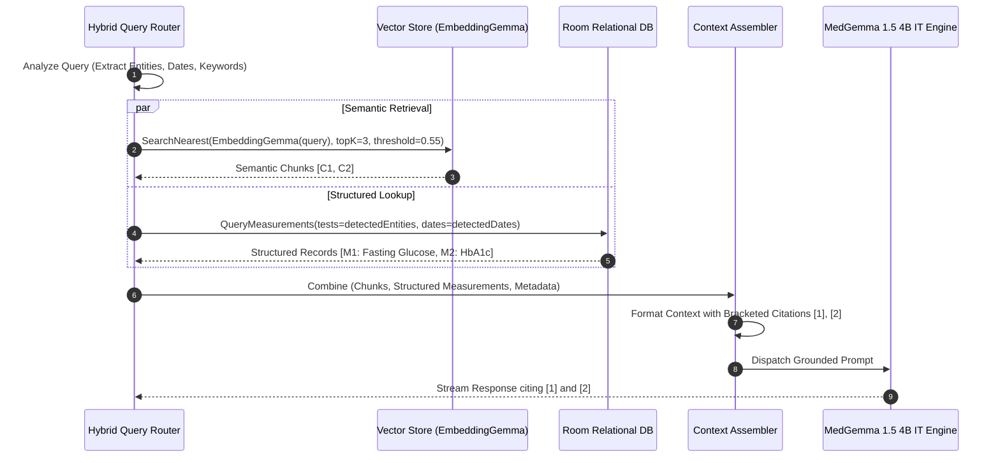

# SwasthAI: Local RAG Architecture & Relational Data Schema

**Document Version:** 1.1.0  
**Classification:** Data Engineering & Retrieval Systems Specification  
**Status:** Approved for Implementation Planning (Revised Single Generative Model Architecture)  

---

## 1. Principles of On-Device Healthcare RAG

Retrieval-Augmented Generation (RAG) in SwasthAI is engineered specifically to eliminate clinical hallucinations and preserve original document truth.
1. **Never Reduce RAG to Prompt Stuffing:** Pasting entire documents into an LLM context exhausts mobile KV caches, increases latency, and causes the model to lose track of exact numerical figures.
2. **Never Rely Exclusively on Vector Search for Numbers:** Vector cosine similarity is notoriously unreliable for distinguishing "242 mg/dL" from "142 mg/dL" or ordering dates. SwasthAI uses **Hybrid Retrieval**: deterministic SQL for numbers and dates, semantic vectors for conceptual context.
3. **Immutable Provenance:** Every chunk, measurement, and footnote maintains a cryptographic link back to the source document, page, and coordinate bounding box.
4. **Vector Store is NOT the Authoritative Record:** The relational SQLite database (Room) is the single source of clinical truth. The vector index is an auxiliary semantic index that can be rebuilt at any time.
5. **Generative Model Explains Verified Data:** MedGemma 1.5 4B IT explains structured, verified clinical facts and retrieved snippets rather than being responsible for discovering raw numbers and dates from unparsed text.

---

## 2. Document Processing & Ingestion Lifecycle

```mermaid
flowchart TD
    DocIn[Raw Medical Document PDF/Image] --> Hash[Compute SHA-256 Checksum]
    Hash --> SecureCopy[Save Encrypted Copy to vault/documents/]
    SecureCopy --> DocEntity[Insert DocumentEntity status=INGESTED]
    
    DocEntity --> TextExtract{Text Extraction Engine}
    TextExtract -->|Digital PDF Stream| RawText[Raw Text + Page Rectangles]
    TextExtract -->|Scanned / Image| OCR[ML Kit On-Device OCR]
    OCR --> RawText
    
    RawText --> LayoutChunker[Layout-Aware Semantic Chunker]
    LayoutChunker --> Chunks[Document Chunks 256-512 Tokens]
    
    par Biomarker Extraction
        RawText --> RegexParser[Deterministic Regex & Table Parser]
        RegexParser --> MeasEntities[Insert StructuredMeasurementEntity]
    and Vector Indexing
        Chunks --> EmbedEngine[Embedding Engine: EmbeddingGemma 300M]
        EmbedEngine --> Vectors[768-dim L2 Normalized Vectors]
        Vectors --> VecStore[Persist ChunkEmbeddings & Vector Index]
    end
    
    MeasEntities --> Finalize[Update DocumentEntity status=INDEXED]
    VecStore --> Finalize
```

---

## 3. Layout-Aware Semantic Chunking & Vector Search

### 3.1 Chunking Rules
* **Window Size:** Target 256–512 tokens with 50-token sliding overlap.
* **Table Row Integrity Rule:** A tabular lab measurement (Test Name, Result, Units, Reference Interval, Flags) must never be split across chunk boundaries.
* **Header Enrichment:** Each chunk is prefixed with contextual breadcrumbs:
  `[Document: {doc_title} | Date: {report_date} | Section: {section_header} | Page: {page_no}]`
  This guarantees that even when an isolated chunk is retrieved, MedGemma understands its temporal and clinical context.

### 3.2 Vector Indexing & Similarity Metric
* **Model:** Dedicated EmbeddingGemma 300M (768-dimensional output).
* **Metric:** Cosine Similarity ($\cos(\theta) = \frac{\mathbf{u} \cdot \mathbf{v}}{\|\mathbf{u}\| \|\mathbf{v}\|}$).
* **Normalization:** All vectors are $L_2$-normalized upon creation, reducing cosine similarity to a fast dot product operation.
* **Retrieval Threshold:** Chunks with cosine similarity score $< 0.55$ (distance $> 0.45$) are discarded to prevent irrelevant context injection.

---

## 4. Hybrid Retrieval & Grounded Context Assembly



### 4.1 Grounded Prompt Template Structure
```
<start_of_turn>user
[SYSTEM INSTRUCTION]
You are SwasthAI, an on-device personal healthcare companion powered by MedGemma.
Answer the user's question using ONLY the provided verified medical context below.
For every claim, cite the source using bracketed numbers like [1] or [2].
If the context does not contain the answer, state clearly: "I cannot find this information in your saved medical records."
Do NOT diagnose or prescribe. Explain all findings in compassionate, accessible language.

[VERIFIED EVIDENCE CONTEXT]
Evidence [1]:
- Document: Complete Blood Count (Dr. Lal PathLabs)
- Report Date: 2025-01-15 | Page 1
- Excerpt: "Hemoglobin: 10.5 g/dL (Reference Range: 12.0 - 15.0 g/dL) [LOW]"

Evidence [2]:
- Document: Comprehensive Health Check (Apollo Clinic)
- Report Date: 2025-08-10 | Page 2
- Excerpt: "Hemoglobin: 12.2 g/dL (Reference Range: 12.0 - 15.0 g/dL) [NORMAL]"

[USER QUESTION]
Did my hemoglobin improve between January and August?
<end_of_turn>
<start_of_turn>model
```

---

## 5. Complete Relational Database Schema (Room / SQLite)

The local SQLite database is managed via Android Jetpack Room with SQLCipher hardware encryption:

### 5.1 `documents`
Stores metadata and file references for all uploaded medical artifacts.

| Column | Data Type | Constraints | Description |
| :--- | :--- | :--- | :--- |
| `id` | `TEXT` | `PRIMARY KEY` | UUIDv4 identifier (`doc_...`) |
| `sha256_hash` | `TEXT` | `NOT NULL, UNIQUE` | File content integrity hash |
| `file_name` | `TEXT` | `NOT NULL` | Original user file name |
| `vault_file_path` | `TEXT` | `NOT NULL` | Absolute path in encrypted app storage |
| `mime_type` | `TEXT` | `NOT NULL` | `application/pdf`, `image/jpeg`, etc. |
| `file_size_bytes` | `INTEGER` | `NOT NULL` | File size |
| `page_count` | `INTEGER` | `NOT NULL DEFAULT 1` | Total pages |
| `clinical_report_date`| `TEXT` | `NULLABLE` | Date test was performed (`YYYY-MM-DD`) |
| `ingested_at` | `INTEGER` | `NOT NULL` | Unix timestamp of import |
| `provider_name` | `TEXT` | `NULLABLE` | Lab/Hospital name (e.g., "Dr. Lal PathLabs") |
| `document_category` | `TEXT` | `NOT NULL` | `LAB_REPORT`, `PRESCRIPTION`, `DISCHARGE`, `OTHER` |
| `indexing_status` | `TEXT` | `NOT NULL` | `PENDING`, `PARSING`, `INDEXED`, `FAILED` |
| `is_confirmed_by_user`| `INTEGER` | `NOT NULL DEFAULT 0`| 1 if user reviewed extracted date/name |

*Indexes:* `idx_documents_report_date (clinical_report_date)`, `idx_documents_category (document_category)`

---

### 5.2 `extracted_document_text`
Stores full extracted text streams per page for rapid search and re-indexing.

| Column | Data Type | Constraints | Description |
| :--- | :--- | :--- | :--- |
| `id` | `TEXT` | `PRIMARY KEY` | UUIDv4 (`txt_...`) |
| `document_id` | `TEXT` | `NOT NULL, FK -> documents(id) ON DELETE CASCADE` | Source document reference |
| `page_number` | `INTEGER` | `NOT NULL` | 1-indexed page number |
| `raw_text` | `TEXT` | `NOT NULL` | Complete text extracted via PDF stream or OCR |
| `extraction_method` | `TEXT` | `NOT NULL` | `NATIVE_PDF`, `ON_DEVICE_OCR` |
| `confidence_score` | `REAL` | `NOT NULL DEFAULT 1.0` | OCR quality confidence (0.0 to 1.0) |

*Indexes:* `idx_extracted_doc_page (document_id, page_number)`

---

### 5.3 `document_chunks`
Stores discrete layout-aware chunks for RAG context assembly.

| Column | Data Type | Constraints | Description |
| :--- | :--- | :--- | :--- |
| `id` | `TEXT` | `PRIMARY KEY` | UUIDv4 (`chk_...`) |
| `document_id` | `TEXT` | `NOT NULL, FK -> documents(id) ON DELETE CASCADE` | Source document reference |
| `page_number` | `INTEGER` | `NOT NULL` | Page where chunk occurs |
| `chunk_index` | `INTEGER` | `NOT NULL` | Sequential chunk order in document |
| `section_header` | `TEXT` | `NULLABLE` | Section (e.g., "Lipid Profile") |
| `chunk_text` | `TEXT` | `NOT NULL` | Text content (256–512 tokens) |
| `token_count` | `INTEGER` | `NOT NULL` | Number of tokens |
| `bounding_box_json`| `TEXT` | `NULLABLE` | Normalized coordinates `{x, y, w, h}` on page |

*Indexes:* `idx_chunks_doc (document_id)`

---

### 5.4 `chunk_embeddings`
Stores on-device vector representations of document chunks.

| Column | Data Type | Constraints | Description |
| :--- | :--- | :--- | :--- |
| `chunk_id` | `TEXT` | `PRIMARY KEY, FK -> document_chunks(id) ON DELETE CASCADE` | Chunk reference |
| `model_identifier` | `TEXT` | `NOT NULL` | `embeddinggemma-300m` |
| `dimensions` | `INTEGER` | `NOT NULL DEFAULT 768`| Vector dimension size |
| `embedding_blob` | `BLOB` | `NOT NULL` | Serialized float32 / int8 vector array |
| `created_at` | `INTEGER` | `NOT NULL` | Timestamp |

---

### 5.5 `structured_measurements`
Stores deterministic clinical laboratory observations extracted from documents.

| Column | Data Type | Constraints | Description |
| :--- | :--- | :--- | :--- |
| `id` | `TEXT` | `PRIMARY KEY` | UUIDv4 (`meas_...`) |
| `document_id` | `TEXT` | `NOT NULL, FK -> documents(id) ON DELETE CASCADE` | Source document |
| `page_number` | `INTEGER` | `NOT NULL` | Source page |
| `raw_test_name` | `TEXT` | `NOT NULL` | Original printed name (e.g., "S. Cholesterol") |
| `canonical_name` | `TEXT` | `NOT NULL` | Normalized enum (e.g., `TOTAL_CHOLESTEROL`) |
| `observed_value` | `REAL` | `NULLABLE` | Numeric value (e.g., 242.0) |
| `string_value` | `TEXT` | `NULLABLE` | Textual value if non-numeric (e.g., "Positive") |
| `unit` | `TEXT` | `NULLABLE` | Standardized unit (e.g., `mg/dL`, `g/dL`) |
| `reference_low` | `REAL` | `NULLABLE` | Reference range lower bound |
| `reference_high` | `REAL` | `NULLABLE` | Reference range upper bound |
| `flag` | `TEXT` | `NOT NULL` | `NORMAL`, `LOW`, `HIGH`, `CRITICAL`, `UNKNOWN` |
| `measurement_date` | `TEXT` | `NOT NULL` | Clinical date (`YYYY-MM-DD`) |
| `provenance` | `TEXT` | `NOT NULL` | `EXTRACTED_UNVERIFIED`, `EXTRACTED_CONFIRMED` |

*Indexes:* `idx_meas_canonical_date (canonical_name, measurement_date)`, `idx_meas_doc (document_id)`

---

### 5.6 `conversations` & `messages`
Stores user dialogue history, context bindings, and grounded citations.

```sql
-- Conversations Table
CREATE TABLE conversations (
    id TEXT PRIMARY KEY NOT NULL,
    title TEXT NOT NULL,
    created_at INTEGER NOT NULL,
    updated_at INTEGER NOT NULL,
    scoped_document_id TEXT NULL,
    is_archived INTEGER NOT NULL DEFAULT 0,
    FOREIGN KEY(scoped_document_id) REFERENCES documents(id) ON DELETE SET NULL
);

-- Messages Table
CREATE TABLE messages (
    id TEXT PRIMARY KEY NOT NULL,
    conversation_id TEXT NOT NULL,
    sender TEXT NOT NULL, -- 'USER', 'ASSISTANT', 'SYSTEM'
    content TEXT NOT NULL,
    created_at INTEGER NOT NULL,
    citations_json TEXT NULL, -- Serialized List<SourceCitation>
    grounding_status TEXT NOT NULL, -- 'GROUNDED', 'GENERAL_KNOWLEDGE', 'EMERGENCY_INTERCEPT'
    FOREIGN KEY(conversation_id) REFERENCES conversations(id) ON DELETE CASCADE
);
CREATE INDEX idx_messages_conv ON messages(conversation_id, created_at);
```

---

### 5.7 `user_confirmed_health_facts` & `medications`
Tracks patient medical history with strict provenance guarantees.

| Table | Primary Key | Key Columns | Provenance & Rules |
| :--- | :--- | :--- | :--- |
| `health_conditions` | `id` | `condition_name`, `diagnosed_year`, `status` (ACTIVE/MANAGED), `provenance` | User confirmed only |
| `allergies` | `id` | `allergen`, `reaction_type`, `severity`, `provenance` | User confirmed only |
| `medications` | `id` | `drug_name`, `dosage`, `frequency`, `is_active`, `source_doc_id` | Requires user confirmation |
| `reminders` | `id` | `medication_id`, `scheduled_time`, `days_mask`, `is_enabled` | Local notification binding |

---

## 6. Cascade Deletion & Index Maintenance Semantics

Maintaining medical privacy requires atomic, irrevocable deletion:
1. When a user deletes a document via the UI:
   - A single Room database transaction deletes the record from `documents`.
   - SQLite `ON DELETE CASCADE` triggers automatically purge:
     - `extracted_document_text`
     - `document_chunks`
     - `chunk_embeddings`
     - `structured_measurements` (with provenance `EXTRACTED_UNVERIFIED`)
   - Any `medications` or `health_conditions` previously verified and accepted by the user are preserved, but their `source_doc_id` is set to `NULL` to maintain continuity while noting the source document was removed.
2. The physical binary file in `context.filesDir/vault/` is shredded via cryptographically random overwrite before filesystem unlinking.
3. In-memory vector caches are updated immediately, ensuring the deleted chunks never appear in future search results.
