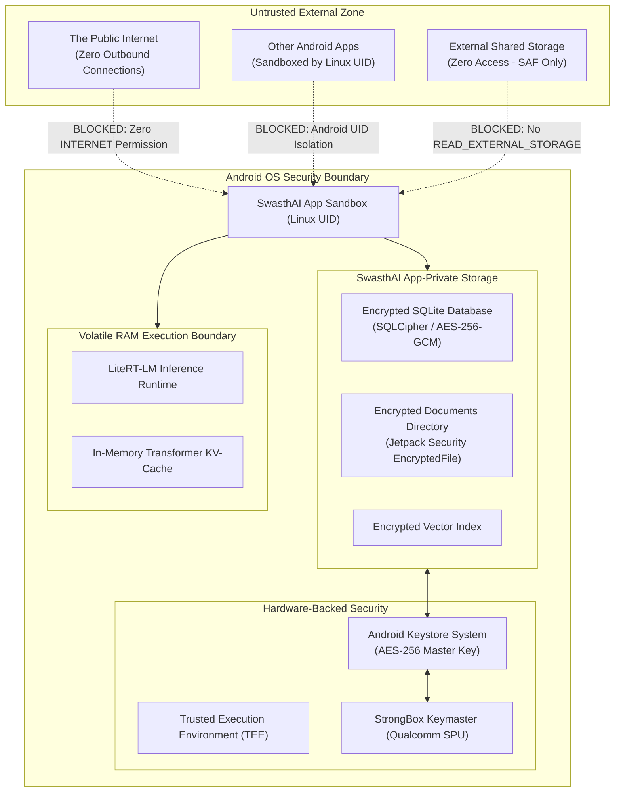

# SwasthAI: Privacy Architecture, Threat Model & Security Specification

**Document Version:** 1.0.0  
**Classification:** Security Engineering & Threat Analysis  
**Status:** Approved for Implementation Planning  

---

## 1. Sensitive Data Inventory & Classification

SwasthAI processes sensitive Personal Health Information (PHI) and Personally Identifiable Information (PII). All data elements are classified according to confidentiality impact:

| Data Asset | Sensitivity Level | Storage Mechanism | Retention Policy | Exposure Risk |
| :--- | :--- | :--- | :--- | :--- |
| **Original Diagnostic Reports** (PDF/Images) | **Critical (Tier 1 PHI)** | App-Private Encrypted Storage (`EncryptedFile`) | Indefinite until explicit user deletion | Extraction of full patient pathology/radiology records |
| **Extracted Lab Biomarkers** (Values, Ranges) | **Critical (Tier 1 PHI)** | Room Database with SQLCipher (AES-256) | Indefinite until document/history deletion | Aggregation of clinical disease markers |
| **Conversation History & RAG Prompts** | **High (Tier 2 PHI)** | Room Database with SQLCipher (AES-256) | User-cleared or permanent local | Leaks user health concerns, symptoms, inquiries |
| **Vector Embeddings (768-dim)** | **Medium (Tier 3 PHI)** | Encrypted Vector File / BLOBs | Regenerable from source documents | Inversion attacks reconstructing semantic fragments |
| **Medication & Appointment Reminders** | **High (Tier 2 PHI)** | Room Database & System `AlarmManager` | Active schedule duration | Discloses chronic pharmaceutical therapies |
| **Model Weight Files** (MedGemma 1.5, EmbeddingGemma)| **Low (Public Weights)**| Unencrypted App Files Cache | Downloaded once / persistent | Model intellectual property (open weights) |

---

## 2. Security Trust Boundaries & System Architecture



---

## 3. Cryptographic Key Management & Storage Protection

### 3.1 Master Key Generation & Hardware Binding
SwasthAI utilizes the **Android Keystore System** backed by Qualcomm StrongBox / TEE (Trusted Execution Environment) on the Snapdragon 8 Elite:
* **Key Spec:** AES-256-GCM (`KeyProperties.KEY_ALGORITHM_AES`, `PURPOSE_ENCRYPT | PURPOSE_DECRYPT`).
* **Block Mode & Padding:** `BLOCK_MODE_GCM`, `ENCRYPTION_PADDING_NONE`.
* **Hardware Isolation:** `setIsStrongBoxBacked(true)` ensures cryptographic operations execute on an isolated tamper-resistant hardware security module.
* **Authentication Binding (Optional Setting):** For high-security mode, keys can require biometric authentication (`setUserAuthenticationRequired(true)`) with a 30-second timeout.

### 3.2 Database Encryption (SQLCipher)
* Relational database tables are encrypted page-by-page using 256-bit AES cipher in CBC mode with HMAC-SHA512 per-page integrity verification.
* Database encryption passphrase is dynamically derived from the Android Keystore master key and never written to persistent disk in plaintext.

### 3.3 File Vault Encryption (`EncryptedFile`)
* Original medical PDFs and images imported into the vault are written using AndroidX `EncryptedFile` with `AES256_GCM_HKDF_4KB` streaming encryption.

---

## 4. Threat Modeling (STRIDE Matrix)

| STRIDE Threat Category | Potential Attack Vector | SwasthAI Mitigation Architecture |
| :--- | :--- | :--- |
| **Spoofing** | Rogue app posing as SwasthAI to intercept documents | Android OS Application Signature verification; unique package namespace. |
| **Tampering** | Modifying stored lab measurements to mislead clinical AI | SQLCipher page-level HMAC checksums detect database tampering; documents verified via SHA-256 hashes. |
| **Repudiation** | User denies entering medication or confirming lab extraction | Relational `provenance` audit flags track exact confirmation timestamps and user action origin. |
| **Information Disclosure** | Data leakage via cloud telemetry or crash reporting | **Zero Internet Permission:** No analytics SDKs (no Firebase, no Mixpanel, no crashlytics transmitting off-device). |
| **Denial of Service** | Maliciously crafted 1,000-page PDF crashing device memory | Strict file size ceiling (< 50MB); streaming chunker with strict per-document token caps. |
| **Elevation of Privilege**| LLM prompt injection triggering unauthorized tool actions | **Human-in-the-Loop:** All state-mutating actions (reminders, records) require manual physical button press. |

---

## 5. Android Permissions Strategy & Attack Surface Minimization

SwasthAI enforces the principle of absolute least privilege:

```xml
<!-- ANDROID MANIFEST PERMISSIONS SPECIFICATION -->
<manifest xmlns:android="http://schemas.android.com/apk/res/android">
    
    <!-- STRICTLY PROHIBITED: NO INTERNET PERMISSION -->
    <!-- <uses-permission android:name="android.permission.INTERNET" /> -->
    <!-- <uses-permission android:name="android.permission.ACCESS_NETWORK_STATE" /> -->

    <!-- ZERO LEGACY STORAGE PERMISSIONS: Use Android Storage Access Framework (SAF) -->
    <!-- <uses-permission android:name="android.permission.READ_EXTERNAL_STORAGE" /> -->
    <!-- <uses-permission android:name="android.permission.WRITE_EXTERNAL_STORAGE" /> -->

    <!-- PERMITTED SYSTEM PERMISSIONS -->
    <!-- Local Notification Scheduling for Care Reminders -->
    <uses-permission android:name="android.permission.POST_NOTIFICATIONS" />
    <uses-permission android:name="android.permission.SCHEDULE_EXACT_ALARM" />
    <uses-permission android:name="android.permission.USE_EXACT_ALARM" />
    
    <!-- Emergency Call Launch (Launches Dialer Intent; Does NOT bypass user dial press) -->
    <!-- No CALL_PHONE required; uses ACTION_DIAL with pre-filled 112 -->
</manifest>
```

---

## 6. Physical & Operational Security Controls

### 6.1 Screen Capture Protection (`FLAG_SECURE`)
* To prevent unauthorized screenshots, background malware screencasting, or app-switcher snapshot leaks, sensitive screens (**Medical Vault Viewer**, **Report Details**, **Chat with Documents**) activate Android's `WindowManager.LayoutParams.FLAG_SECURE`.

### 6.2 Cryptographic Shredding on Deletion
* Simply unlinking an inode on flash memory leaves magnetic/NAND traces. When a user commands document deletion:
  1. The target file is overwritten with pseudorandom bytes (0xAA, 0x55, 0x00).
  2. The file is truncated to 0 bytes and unlinked.
  3. Relational records and embedding vectors are purged in an atomic SQLite transaction.

---

## 7. Security Acceptance Criteria

* **SEC-AC-01 (Air-Gap):** Android Studio Network Profiler records zero transmitted bytes over cellular and Wi-Fi interfaces during a 30-minute stress test involving 10 document imports and 50 chat turns.
* **SEC-AC-02 (Keystore Verification):** Master encryption key generation verified to execute inside Qualcomm StrongBox / TEE.
* **SEC-AC-03 (Encrypted Storage):** Pulling the app's SQLite database file via `adb pull` from a rooted emulator reveals an unparseable binary stream; SQLite tools report `file is not a database` without the key.
* **SEC-AC-04 (Screen Capture):** Android OS blocks screenshots and renders a black screen in the recent-apps switcher for all views displaying medical records.
