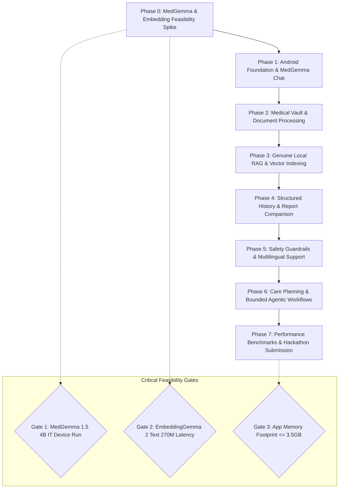

# SwasthAI: Implementation Roadmap & Technical Feasibility Gates

**Document Version:** 1.2.0  
**Classification:** Engineering Project Plan  
**Status:** Phase 0 Feasibility Findings Updated (Test Harness Created)  

---

## 1. Roadmap Strategy & Dependency Sequence

The implementation of SwasthAI follows a phased, dependency-aware structure. Each phase defines strict **Entry Criteria**, **Core Deliverables**, **Exit/Acceptance Criteria**, and **Feasibility Gates**.

---

## 2. Phase Breakdown

### Phase 0: Model Feasibility Spike (Status: In Progress / Harness Built)
* **Focus:** Verify runtime compatibility, model artifacts, quantization tools, and target hardware memory budgets on physical Galaxy S25.
* **Entry Criteria:** Hardware device (Samsung Galaxy S25, `SM-S931B`) verified connected via USB (`RZGL325K28P`).
* **Completed Spike Deliverables:**
  - Verified community-converted artifact: `litert-community/MedGemma-1.5-4B-IT` (`medgemma-1.5-4b-it_q4_block32_ekv2048.litertlm`, 2.41 GiB).
  - Verified embedding artifact: `litert-community/embeddinggemma-2-text-270m-litert-lm` (768 dimensions, 8K context, MRL support).
  - Built minimal isolated test application module: `:model-test-harness` with Jetpack Compose UI, LiteRT-LM `Engine` loader, real-time token streaming, benchmark metrics logger, and error handling.
  - Implemented repeatable benchmark prompts: General Health, Medical Terminology, Synthetic Lab Panel, and Self-Contained Multi-Turn Scenario.
  - Implemented `EmbeddingGemmaProbe` validating official task prefixes (`task: search result | query: ` and `title: {title} | text: {chunk}`).
* **Remaining Gate 1 Action on Device:**
  - User downloads 2.41 GiB model file from Hugging Face and pushes to `/sdcard/Download/` via `adb push`.
  - Launch `:model-test-harness` on Galaxy S25 and record cold-start, TTFT, tps, and peak RSS.
* **Exit Criteria:** Measured generation on device with peak RSS <= 3.5 GB and coherent output across 3 benchmark prompts.

---

### Phase 1: Mobile Foundation & Local AI Chat
* **Focus:** Establish clean multi-module architecture, navigation, secure local database, and streaming chat with MedGemma.
* **Entry Criteria:** Phase 0 Gate 1 device benchmark completed with a GO decision.
* **Tasks:**
  - Initialize multi-module Gradle project structure (`:app`, `:core:...`, `:feature:...`, `:ai:...`).
  - Configure Jetpack Compose Material 3 theme, accessible typography, and dark/light palettes.
  - Set up Android Keystore AES-256 master key generation and SQLCipher Room database initialization.
  - Build `LlmEngine` wrapper around MedGemma 1.5 4B IT with Kotlin Coroutines streaming flow.
  - Implement application-level turn re-formatter to manage multi-turn history.
  - Implement Chat UI with real-time token streaming, stop generation control, and persistent conversation threads.
* **Exit Criteria:** Fluid, offline multi-turn chat operating on device with zero crashes across 10 turns.

---

### Phase 2: Medical Vault & Document Processing
* **Focus:** Build encrypted document storage, file ingestion, native PDF parsing, and on-device OCR.
* **Entry Criteria:** Phase 1 complete; encrypted Room database active.
* **Tasks:**
  - Implement Android Storage Access Framework (SAF) document picker for PDFs and images.
  - Set up `EncryptedFile` storage in app-private sandbox with SHA-256 integrity checks.
  - Develop dual-path text extractor: digital PDF text stream reader + fallback ML Kit on-device OCR.
  - Build Medical Vault UI: chronological report list, extraction progress indicator, and integrated PDF document viewer.
  - Implement user review/confirmation sheet for extracted metadata (date, provider).
* **Exit Criteria:** Ingestion and OCR parsing of 2-page synthetic blood report executes on device in < 4.0 seconds with zero cloud calls.

---

### Phase 3: Genuine Local RAG Pipeline
* **Focus:** Implement layout-aware chunking, vector embeddings, vector store, and grounded retrieval.
* **Entry Criteria:** Phase 2 document extraction stable.
* **Tasks:**
  - Develop layout-aware semantic chunker (256–512 tokens) preserving clinical table rows.
  - Integrate EmbeddingGemma 2 Text 270M model via LiteRT embedding API (768-dim normalized vectors).
  - Implement local Vector Store with Cosine Similarity search and metadata foreign keys.
  - Build Hybrid Query Router (directing entity/date queries to Room and semantic queries to vector store).
  - Construct grounded prompt generator with strict citation format `[1]`, `[2]`.
  - Connect Chat UI with interactive Grounding Badge and Document Coordinate Jump drawer.
* **Exit Criteria:** End-to-end RAG query retrieves accurate source chunks in < 60ms and generates answer citing exact page.

---

### Phase 4: Structured Medical History & Report Comparison
* **Focus:** Build deterministic biomarker extraction, range evaluation, and multi-report trend analytics.
* **Entry Criteria:** Phase 3 RAG and extraction operational.
* **Tasks:**
  - Implement deterministic regex and rule parser for standard lab panels (Lipid, CBC, HbA1c, Metabolic).
  - Build deterministic reference range comparator (LOW, NORMAL, HIGH, CRITICAL).
  - Construct `structured_measurements` table with four-tier provenance flags.
  - Develop Report Comparison Engine: SQL join matching identical biomarkers across two selected report dates.
  - Build Report Comparison UI with visual deltas, percentage changes, and directional badges.
  - Connect MedGemma to generate plain-language narrative summarizing verified comparison data.
* **Exit Criteria:** Flawless comparison of synthetic Jan 2025 vs Aug 2025 blood tests showing correct deltas and trends.

---

### Phase 5: Healthcare Safety & Multilingual Support
* **Focus:** Implement emergency escalation, hallucination guardrails, and Hindi language support.
* **Entry Criteria:** Phase 4 completed.
* **Tasks:**
  - Build Pre-LLM Deterministic Emergency Triage Filter (intercepting chest pain, stroke, severe bleeding, etc.).
  - Implement full-screen Emergency Alert Modal with single-tap `tel:112` dialer intent.
  - Implement post-generation numerical fact checker flagging ungrounded numbers.
  - Add Hindi system prompt templates for MedGemma and UI string localization; ensure clinical entity preservation in Latin script.
  - Conduct linguistic and clinical safety audit across 20 synthetic edge-case scenarios.
* **Exit Criteria:** 100% emergency interception rate; zero false claims of automated emergency dispatch.

---

### Phase 6: Care Planning & Bounded Agentic Workflows
* **Focus:** Bounded local tools, medication scheduling, and doctor summary generation.
* **Entry Criteria:** Phase 5 safety guardrails active.
* **Tasks:**
  - Define strict JSON tool schemas for MedGemma (`search_vault`, `get_biomarkers`, `create_reminder`).
  - Implement Human-in-the-Loop Confirmation Gate (state mutations require explicit button press).
  - Build Medication & Appointment Reminder engine using Android `WorkManager` / `AlarmManager`.
  - Develop Doctor Visit Summary Generator exporting a clean 1-page PDF summary.
* **Exit Criteria:** User-confirmed reminder schedules system notification at exact local time in airplane mode.

---

### Phase 7: Physical Device Benchmarks & Hackathon Submission
* **Focus:** Reproducible performance benchmarking, memory profiling on Galaxy S25, demo rehearsal, and submission assets.
* **Entry Criteria:** All P0 and selected P1 features implemented.
* **Tasks:**
  - Execute full Galaxy S25 Reproducible Benchmark Suite (cold-start, warm-start, TTFT, tps, peak RSS, thermals).
  - Verify total application peak memory <= 3.5 GB RSS via `dumpsys meminfo`.
  - Verify complete offline air-gap via Network Profiler (0 bytes transmitted).
  - Finalize One-Slide Impact Plan and record 60-second video demonstration.
  - Complete live demo walkthrough rehearsal.
* **Exit Criteria:** Flawless end-to-end live demonstration on Galaxy S25 in airplane mode.

---

## 3. Technical Feasibility Gates & Risk Milestones

| Gate ID | Technical Check | Pass Criteria | Current Status & Fallback Action |
| :--- | :--- | :--- | :--- |
| **Gate 1** | MedGemma 1.5 4B IT Feasibility | Loads via LiteRT-LM on Galaxy S25, generates text, RSS <= 3.5 GB | **In Progress:** Artifact identified on Hugging Face (`litert-community/MedGemma-1.5-4B-IT`); `:model-test-harness` built; pending user model push to device. Fallback: `gemma-4-E2B-it-litert-lm`. |
| **Gate 2** | EmbeddingGemma 2 Text 270M | 256-token chunk embedded in < 35ms on Galaxy S25 | **Harness Ready:** Artifact identified (`litert-community/embeddinggemma-2-text-270m-litert-lm`); contract probe implemented. Fallback: BGE-micro (ONNX). |
| **Gate 3** | App Peak Memory Budget | Total app RSS <= 3.5 GB under active inference & UI | Enforce strict sequential model unloading between ingestion and chat. |
| **Gate 4** | OCR Character Accuracy | Accuracy >= 90% on synthetic 300 DPI lab scans | Fallback to digital PDF stream priority; alert user if scan is unreadable. |
| **Gate 5** | Deterministic Emergency Filter | Intercepts 20/20 critical prompts in < 10ms | Expand regex dictionary; block LLM invocation on any high-risk keyword. |
